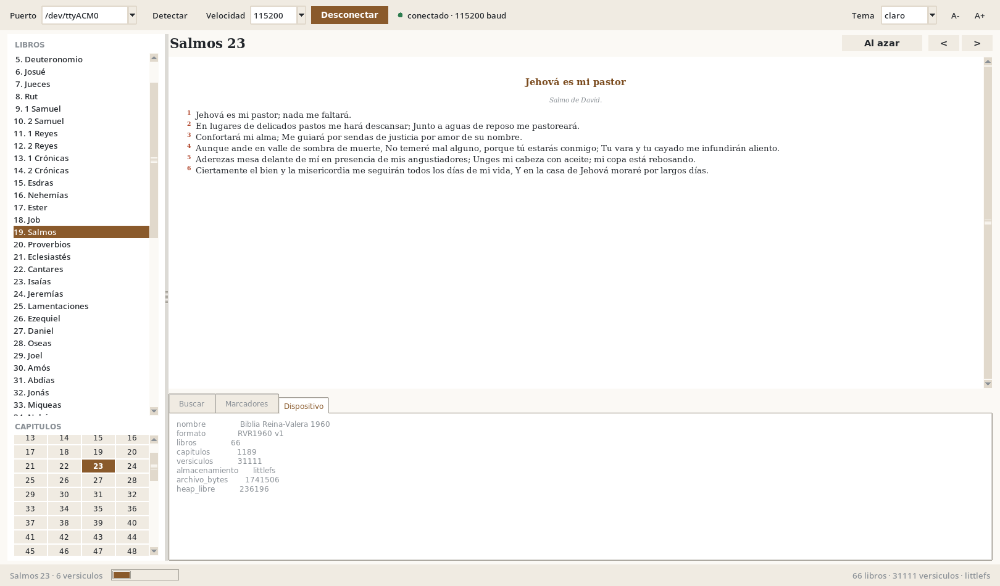
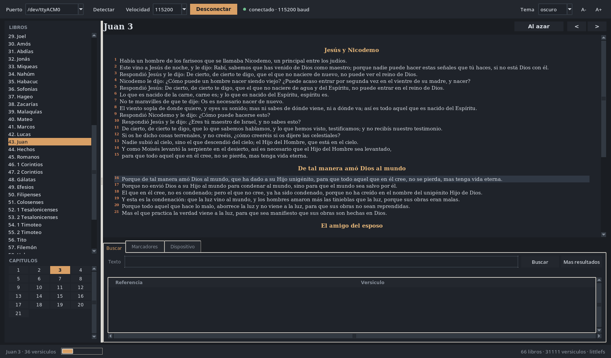
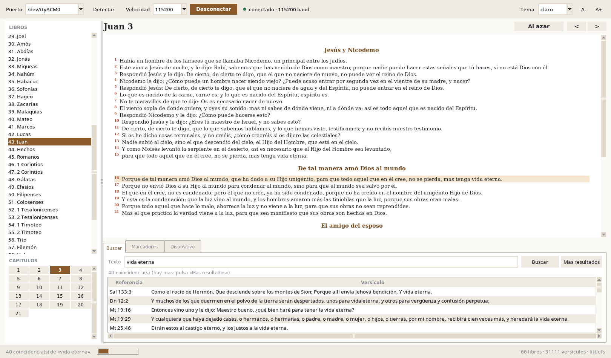

# Biblia electrónica RVR1960 en ESP32


Lector de la Biblia Reina-Valera 1960 que vive en un **ESP32** y entrega el texto
por el puerto serie. El JSON original (21.9 MB) se convierte en una base binaria
compacta de **1.66 MB** con compresión por capítulo; la placa descomprime cada
capítulo en RAM y responde a los comandos de lectura y búsqueda. En el PC hay
tres formas de usarlo: lector interactivo de terminal, interfaz gráfica y
comandos de una sola línea.

```
RVR1960_vid_149.json --(build_bible.py)--> data/bible.dat --(serie)--> ESP32
                                                                          |
                    biblia.py / biblia_gui.py  <--------------------------+
```

| Tema claro | Tema oscuro |
| :---: | :---: |
|  |  |



## Inicio rápido

```bash
pip install -r requirements.txt       # solo pyserial
make flash  PORT=/dev/ttyACM0         # graba el firmware
make upload PORT=/dev/ttyACM0         # carga data/bible.dat (6-10 min a 115200)
make gui    PORT=/dev/ttyACM0         # lee en la interfaz gráfica
```

Si prefieres partir del JSON y no del `bible.dat` incluido, coloca
`RVR1960_vid_149.json` en la raíz y ejecuta antes `make data`.

Los mismos pasos a mano, y todos los detalles, están en las secciones siguientes.

## Contenido

| Ruta | Descripción |
| --- | --- |
| `tools/build_bible.py` | Extrae el JSON y genera `data/bible.dat` |
| `tools/biblia.py` | Cliente serie: lector interactivo, búsquedas, carga de datos |
| `tools/biblia_gui.py` | Interfaz gráfica de lectura (tkinter) con puerto y velocidad a elegir |
| `tools/sim_esp32.py` | Simulador del firmware sobre un PTY (para probar sin placa) |
| `firmware/esp32_biblia/` | Sketch de Arduino para la ESP32 + `partitions.csv` |
| `data/bible.dat` | Base binaria incluida en el repositorio (66 libros, 1189 capítulos, 31111 versículos) |
| `docs/img/` | Capturas de la interfaz usadas en este README |
| `requirements.txt` | Dependencias del host (`pyserial`) |
| `Makefile` | Atajos para generar, grabar, cargar y leer |

`RVR1960_vid_149.json` **no** está en el repositorio (22 MB y texto con derechos
editoriales): aporta el tuyo y ejecuta `make data` para reconstruir `bible.dat`.

### Atajos con `make`

| Comando | Qué hace |
| --- | --- |
| `make data` | Genera `data/bible.dat` desde el JSON |
| `make compile` / `make flash` | Compila y graba el firmware (usa `PORT=`) |
| `make upload` | Envía los datos por el puerto serie |
| `make read` / `make gui` | Lector interactivo / interfaz gráfica |
| `make sim` / `make test` | Simulador sin placa / comprobaciones del binario |

`make help` lista los atajos y `make VARIABLE=valor` cambia `PY`, `PORT`
(`/dev/ttyUSB0` por omisión), `BAUD` (115200) o `FQBN`.

## 1. Requisitos

- Python 3.8+ con `pyserial`: `pip install -r requirements.txt`
- `python3-tk` si vas a usar la interfaz gráfica (en Debian/Ubuntu:
  `sudo apt install python3-tk`)
- `arduino-cli` (o el IDE de Arduino) con el core **esp32 3.x**
  (`arduino-cli core install esp32:esp32`)
- Placa ESP32 con **4 MB de flash** o más y su cable USB
- Permiso para el puerto serie
  (`sudo usermod -aG dialout $USER`, luego cerrar y abrir sesión)

## 2. Generar la base de datos

Coloca `RVR1960_vid_149.json` en la raíz del proyecto y ejecuta:

```bash
python3 tools/build_bible.py
```

Si el JSON está en otro sitio, indícalo con `--input` (y `--output`):

```bash
python3 tools/build_bible.py --input ~/datos/RVR1960_vid_149.json
```

Resultado:

```
libros      : 66
capitulos   : 1189
versiculos  : 31111
texto plano : 3.82 MB -> comprimido 1.64 MB (43 %)
cap. mayor  : PSA.119 = 12810 B descomprimido, 4608 B comprimido
```

El script limpia el HTML, descarta los capítulos duplicados que trae el JSON
en los libros de un solo capítulo, conserva los títulos de sección como líneas
`# …` y guarda la numeración real de los 6 capítulos que tienen versículos
omitidos o repetidos.

## 3. Compilar y grabar el firmware

```bash
arduino-cli compile --fqbn esp32:esp32:esp32 firmware/esp32_biblia
arduino-cli upload  -p /dev/ttyUSB0 --fqbn esp32:esp32:esp32 firmware/esp32_biblia
```

Desde el IDE de Arduino: abrir `firmware/esp32_biblia/esp32_biblia.ino`,
seleccionar la placa **ESP32 Dev Module** y grabar. El archivo
`partitions.csv` que está junto al sketch se aplica automáticamente y reserva
1.81 MB para el programa y 2.06 MB para LittleFS.

Cableado: solo el USB. El firmware habla a **115200 baudios** (se cambia en
`biblia_config.h` con `BIB_BAUD`; el cliente y el monitor serie deben usar la
misma velocidad). El puerto depende del chip USB de la placa: `/dev/ttyACM0` en
las que llevan CH343 o nativo, `/dev/ttyUSB0` en las que llevan CP2102 o CH340;
`python3 tools/biblia.py ports` lo detecta solo.

## 4. Cargar los datos por el mismo puerto serie

Con la placa ya grabada:

```bash
python3 tools/biblia.py upload
```

El cliente envía `data/bible.dat` en bloques de 192 bytes y muestra el avance;
tarda unos 6-10 minutos a 115200 baudios. Si vas a recargar los datos a menudo,
sube `BIB_BAUD` (y `--baud` del cliente) a 460800 o 921600 para que baje a
menos de dos minutos. La carga no es necesaria al regrabar el firmware: el
archivo queda en LittleFS.

Alternativa con tarjeta SD (recomendada si tienes lector): copia `bible.dat`
en la raíz de la tarjeta, pon `#define BIB_USE_SD 1` en `biblia_config.h`,
ajusta los pines `BIB_SD_*` y vuelve a compilar. La lectura es más rápida y no
consume flash.

## 5. Leer

```bash
python3 tools/biblia.py                  # lector interactivo
python3 tools/biblia.py juan 3:16        # un versículo
python3 tools/biblia.py read "sal 23"    # un capítulo
python3 tools/biblia.py read "1 co 13"   # acepta números, USFM, abreviaturas y nombres
python3 tools/biblia.py search pastor    # búsqueda con tildes opcionales
python3 tools/biblia.py random           # versículo al azar
python3 tools/biblia.py info             # estado del dispositivo
python3 tools/biblia.py ports            # puertos y detección automática
```

El puerto se detecta solo; si hay varios, usa `--port /dev/ttyUSB0`
(`COM3` en Windows). Otras opciones: `--baud`, `--width 100`, `--no-color`.

### Lector interactivo

```
Gn 1> juan 3        ir al capítulo            n / p   siguiente / anterior
Jn 3> 3:16          ir al versículo           r       versículo al azar
Jn 3> /amor         buscar                   /       más resultados
Jn 3> m             marcar el capítulo        ml      listar marcas
```

Enter muestra el capítulo siguiente; `b` lista los libros, `i` la información
del dispositivo, `w 90` cambia el ancho de línea y `q` sale. Las marcas se
guardan en `~/.local/share/biblia/bookmarks.json`.

### Interfaz gráfica

```bash
python3 tools/biblia_gui.py                    # elige puerto y velocidad en la ventana
python3 tools/biblia_gui.py --port /dev/ttyACM0 --baud 115200
make gui PORT=/dev/ttyACM0
```

Solo necesita Python con tkinter (paquete `python3-tk`) y `pyserial`. La ventana
tiene:

- **barra superior** con puerto, velocidad, `Conectar`/`Desconectar`, indicador de
  estado, tema (claro, sepia, oscuro) y tamaño de letra;
- **lista de los 66 libros** y rejilla de capítulos a la izquierda;
- **panel de lectura** con títulos de sección centrados, números de versículo en
  color y el versículo buscado resaltado;
- **pestaña Buscar** con resultados paginados (doble clic para ir al pasaje);
- **pestaña Marcadores** compartida con el lector interactivo;
- **pestaña Dispositivo** con el estado que devuelve `info`;
- **Archivo → Enviar datos a la placa...** para cargar `bible.dat` con barra de
  progreso y botón de cancelar.

Atajos: flechas izquierda/derecha (capítulo anterior/siguiente), `Ctrl+F` buscar,
`Ctrl+G` ir a referencia, `Ctrl+R` aleatorio, `Ctrl+K` conectar, `F5` detectar
puertos. El clic derecho sobre el texto copia el versículo o el capítulo. La
última posición, el tema y el tamaño de letra se recuerdan en
`~/.config/biblia/gui.json`.

Si abres el Monitor Serie del IDE de Arduino, cierra antes la interfaz (y al
revés): el puerto solo admite un programa a la vez.

## 6. Protocolo serie

Texto UTF-8, un comando por línea. Cada respuesta termina en `[OK]` (con datos
opcionales) o `[ERR] código mensaje`. Los datos van etiquetados:

| Prefijo | Significado |
| --- | --- |
| `i\|clave\|valor` | información del dispositivo |
| `b\|n\|usfm\|corto\|nombre\|capítulos` | un libro |
| `h\|texto` | título de sección |
| `~\|texto` | etiqueta (por ejemplo «Alef») |
| `v\|número\|texto` | versículo |
| `m\|referencia\|texto` | resultado de búsqueda |

| Comando | Respuesta |
| --- | --- |
| `ping` | `[OK] pong` |
| `info` / `help` / `books` | datos del dispositivo |
| `chap <libro> [capítulo]` | capítulo completo |
| `verse <libro> <capítulo>[:<versículo>]` | uno o varios versículos |
| `find <texto>` | hasta 40 coincidencias |
| `find <desde> <límite> <texto>` | continúa la búsqueda desde un capítulo |
| `rand` | versículo aleatorio |
| `putbegin <bytes>` / `put <offset> <hex>` / `putend <bytes>` | carga del archivo |

`<libro>` acepta número (1-66), código USFM (`JHN`), abreviatura (`Jn`) o
nombre (`Juan`). La búsqueda ignora mayúsculas y tildes (`corazon` encuentra
`corazón`) y responde con el capítulo por el que conviene continuar, de modo
que el cliente pagina sin descargar todo el texto.

Puedes probarlo a mano con `screen /dev/ttyUSB0 115200` y escribiendo `chap jn 3`.

## 7. Formato de `data/bible.dat`

Little endian, versión 1. Cabecera de 64 bytes (`magic "RVR1960"`, versión,
número de libros/capítulos/versículos, offsets de cada tabla); tabla de 66
libros de 64 bytes; tabla de 1189 capítulos de 16 bytes (libro, capítulo,
número de versículos, offset, longitud comprimida y sin comprimir, offset de la
numeración irregular); sección de numeración; y los bloques `deflate` de cada
capítulo. El firmware usa `tinfl_decompress_mem_to_mem` de la ROM del ESP32:
no hace falta ninguna biblioteca de compresión externa.

Cambios en el formato implican ajustar `FORMAT_VERSION` en
`tools/build_bible.py` y `kFormatVersion` en `bible_store.cpp`.

## 8. Placas con más flash

Para 8 MB o 16 MB basta cambiar `partitions.csv` (por ejemplo 3 MB para la app
y 4 MB para LittleFS) y marcar en el IDE la placa o el esquema que
corresponda. Si prefieres SD, `BIB_USE_SD 1` y ajusta los pines.

## 9. Probar sin hardware

```bash
python3 tools/sim_esp32.py            # crea un PTY y atiende el protocolo
python3 tools/biblia.py --port /dev/pts/8 upload    # en otra terminal
python3 tools/sim_esp32.py --selftest # comprobaciones del archivo binario
```

El simulador lee `data/bible.dat` y responde exactamente igual que el
firmware, incluido el protocolo de carga.

## 10. Problemas comunes

- **«no responde al protocolo»**: el monitor serie está abierto en otra
  aplicación, o la placa no tiene el firmware. Cierra el monitor y reintenta.
- **«el dispositivo no tiene datos cargados»**: falta ejecutar `upload`.
- **`Permission denied` en el puerto**: agrega tu usuario al grupo `dialout`.
- **Texto ilegible en el monitor serie**: usa 115200 baudios y UTF-8 (es la
  velocidad del monitor serie del IDE de Arduino).
- **La primera búsqueda tarda**: la ESP32 descomprime capítulo por capítulo
  (1.66 MB); en la SD baja a la mitad del tiempo.
- **`partitions.csv` no aplicado**: en el IDE, mantén la placa
  «ESP32 Dev Module»; el archivo junto al sketch manda sobre el esquema del menú.
- **Reinicios con «Stack canary watchpoint triggered»**: el descompresor de la
  ROM usa varios KB de pila. El sketch ya declara
  `SET_LOOP_TASK_STACK_SIZE(32 * 1024)`; si agregas trabajo pesado en `loop()`,
  sube ese valor.

## 11. Aviso sobre el texto bíblico

El texto Reina-Valera 1960 tiene derechos de autor de las Sociedades Bíblicas
Unidas. Este proyecto solo reorganiza el JSON que ya estaba en la carpeta para
uso personal y de estudio; revisa las condiciones del editor antes de
distribuir el texto o los binarios generados. Por eso el JSON de entrada no se
versiona y `data/bible.dat` se incluye únicamente para comodidad de quien ya
tiene acceso al texto.

## 12. Licencia

El **código** (scripts de Python, sketch de Arduino, Makefile y documentación)
se distribuye bajo licencia MIT: consulta [LICENSE](LICENSE). Dicha licencia no
se extiende al texto de la Reina-Valera 1960, que sigue las condiciones de sus
editores (ver el aviso anterior).

## 13. Contribuir

1. Abre un *issue* describiendo el problema o la mejora.
2. Crea una rama, mantén el estilo del código (comentarios y textos de interfaz
   en español, sin tildes en los identificadores) y prueba con
   `make test` y el simulador: `make sim`.
3. Envía el *pull request* explicando qué cambia y cómo lo probaste. La
   integración continua (`.github/workflows/ci.yml`) comprueba la sintaxis y
   valida `data/bible.dat` con el simulador en Python 3.8 y 3.12, sin hardware.

Si modificas el formato binario, sube `FORMAT_VERSION` en
`tools/build_bible.py` y `kFormatVersion` en `bible_store.cpp`, y documenta el
cambio en la sección 7.
